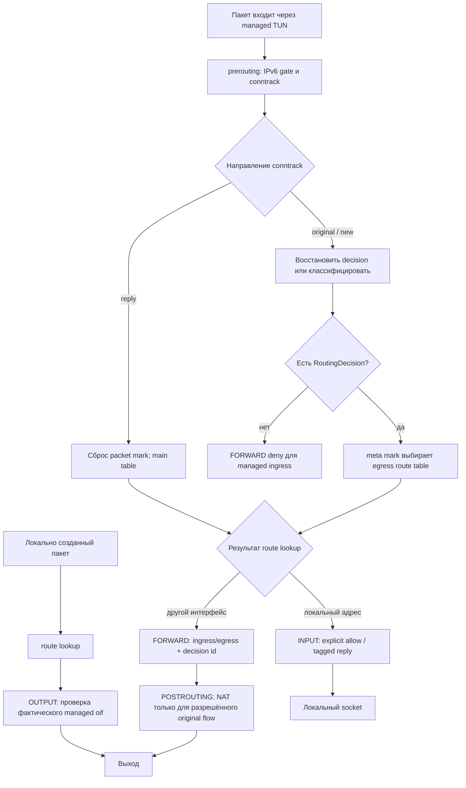

# nftables, маршрутизация и NAT в vpn-relay

Документ описывает реализацию на ветке `feature/vpn-relay-firewall-nat`.
Основные компоненты:

- `vpn-relay/src/config.rs` — TOML-модель и валидация.
- `vpn-relay/src/routing.rs` — единая модель routing decisions и генерация nftables.
- `vpn-relay/src/linux.rs` — применение nftables и policy routing, проверка владения.
- `vpn-relay/src/runtime.rs` — startup/shutdown, блокировка экземпляра и sysctl.
- `vpn-relay/src/backend/` — backend-neutral lifecycle и BoringTun WG/AWG backend.

## Путь пакета и порядок hooks

Ниже показан путь для managed TUN ingress. Локальный и транзитный трафик
разделяются после prerouting; OUTPUT проверяет фактический интерфейс,
выбранный маршрутизацией ядра.



Для OUTPUT пакетов conntrack host-flow tag выставляется только явным allow
правилом. INPUT/OUTPUT reply допускается только в reply direction при наличии
этого tag; одного `ct state established,related` недостаточно.

## Область управления

vpn-relay управляет только трафиком, который входит или выходит через
интерфейсы из `[interfaces]`. Таблица nftables имеет family `inet`,
настраиваемое имя `[daemon].nft_table` и table-level ownership comment
`managed by vpn-relay`.

INPUT, OUTPUT и FORWARD base chains используют `policy accept`: vpn-relay
не устанавливает глобальную политику хоста и не заменяет системный firewall.
Каждая цепочка ограничивает свои правила managed TUN интерфейсами. Поэтому
обычный физический/unmanaged ingress и egress не должны попадать под
vpn-relay deny rules. Остальные nftables base chains продолжают действовать
независимо; drop в другой base chain не отменяется accept в таблице vpn-relay.


### Фиксированные security defaults

Политики безопасности не переключаются конфигурационными флагами:

- INPUT: явные allow rules для managed ingress, затем deny для остального
  managed ingress;
- OUTPUT: явные allow rules для фактического managed TUN egress, затем deny
  для остального managed egress;
- FORWARD: разрешение только для потока с выбранным routing decision и
  соответствующей парой ingress/egress; unmatched и invalid managed traffic
  блокируется;
- NAT: применяется только к разрешённому original-direction FORWARD flow,
  выбранному тем же routing decision.

policy accept у base chains означает только то, что vpn-relay не меняет
глобальную политику host namespace. Это не отменяет локальный deny внутри
managed hooks. Отсутствие firewall allow rules эквивалентно deny для
соответствующего managed INPUT/OUTPUT направления. Отдельных параметров
input_policy, output_policy или forward_policy конфигурация не имеет.


## Конфигурационная модель

Направление определяется каждым routing rule, а не ролью интерфейса:

```toml
[[routing.rules]]
priority = 100
ingress = "wg-server"
source = ["10.10.0.0/24"]
destination = ["0.0.0.0/0"]
egress = "awg-primary"
nat = "masquerade"
```

`priority` задаёт порядок в пределах одного ingress; `ingress` и
`egress` — managed TUN интерфейсы; `source` и `destination` — необязательные
CIDR selectors. NAT поддерживает `none`, `masquerade` и статический `snat`
с обязательным `nat_to` для последнего.

Один интерфейс может участвовать в разных правилах и в разных направлениях.
Списки `source` и `destination` могут содержать IPv4 и IPv6 CIDR
одновременно. Сопоставление выполняется только внутри одного семейства:
IPv4 source не образует пару с IPv6 destination и наоборот. Точные
повторяющиеся строки CIDR в одном списке отклоняются при загрузке конфигурации.

Самоссылочные правила запрещены. Приоритеты должны быть уникальны для одного
ingress. Первое совпавшее правило классифицирует новый flow; более поздние
правила для него уже не рассматриваются.

Firewall INPUT rules используют source CIDR, OUTPUT rules — destination CIDR.
Они могут ограничивать протокол (TCP, UDP, ICMP, ICMPv6); порты допустимы
только для TCP/UDP. Эти allow rules относятся к host INPUT/OUTPUT, а не
заменяют routing rules для FORWARD.

## Conntrack и routing decision

У каждого уникального routing rule есть отдельный `RoutingDecision`, даже
если несколько решений используют один egress. Это необходимо, чтобы NAT и
обратный FORWARD использовали именно то правило, которое выбрало первый
пакет, а не повторно вычисляли совпадение по потенциально перекрывающимся
selectors.

- `meta mark` содержит routing mark egress и выбирает iproute2 table.
- Старшие 16 бит `ct mark` зарезервированы за vpn-relay.
- Диапазон `0x4001`–`0x4fff` содержит идентификаторы routing decisions;
  конфигурация ограничена 4095 routing rules.
- Значение `0x8000` помечает локальные host flows, прошедшие явное INPUT
  или OUTPUT разрешение.
- Младшие 16 бит `ct mark` сохраняются для host policy/QoS.

Для нового flow prerouting классифицирует пакет по ingress, source и
destination. При совпадении выставляются оба mark и выполняется return.
Для последующих пакетов original direction routing mark восстанавливается
из decision id в conntrack. Пакет reply direction получает нулевой packet
mark и использует main table для возврата к исходному ingress.

Routing marks выделяются только интерфейсам, которые реально используются
как egress. Для каждого egress создаются отдельные таблица маршрутизации,
default route и fwmark rule. Socket fwmarks — отдельный класс: для них
создаются правила с более высоким приоритетом, возвращающие внешний
зашифрованный WG/AWG UDP transport в main table.

## INPUT: host traffic с managed TUN

INPUT base chain:

1. Отбрасывает `ct state invalid` только для managed ingress.
2. Разрешает original-direction пакеты, совпавшие с явными
   `[firewall.input.rules]`.
3. Разрешает established/related reply-direction пакеты, только если
   conntrack entry имеет host-flow tag `0x80000000`, установленный явным
   OUTPUT allow rule для исходного host-initiated flow.
4. Отбрасывает весь остальной managed ingress.

Пакеты с unmanaged ingress и loopback не охватываются этими правилами.
INPUT allow rule не является разрешением FORWARD.

## OUTPUT: host traffic в managed TUN

INPUT/OUTPUT allow rules устанавливают host-flow tag, меняя только старшие
16 бит `ct mark` и сохраняя младшие 16. Поэтому established/related сам по
себе не является разрешением: reply на физическом интерфейсе или на flow,
не прошедший managed allow rule, не получает этот tag и не принимается через
managed TUN.

OUTPUT base chain:

1. Отбрасывает `ct state invalid` только при фактическом managed TUN egress.
2. Разрешает original-direction пакеты, совпавшие с явными
   `[firewall.output.rules]`.
3. Разрешает established/related reply-direction пакеты, только если
   conntrack entry имеет host-flow tag `0x80000000`, установленный явным
   INPUT allow rule для исходного client-initiated flow.
4. Отбрасывает остальной managed egress.

Проверяется фактический `oifname`, а не socket mark. Поэтому внешний
зашифрованный UDP, маршрутизируемый через физический/unmanaged интерфейс,
не должен попадать под managed OUTPUT deny.

## FORWARD: транзит между managed TUN и другими интерфейсами

Для FORWARD действует fail-closed модель:

- новый flow разрешается только если prerouting выбрал routing decision,
  а ingress/egress и routing mark совпадают с этим решением;
- original-direction established пакеты продолжают использовать сохранённый
  decision id и routing mark;
- reply-direction разрешается только в обратной паре egress → ingress и при
  совпадении decision id в conntrack;
- invalid пакеты с managed ingress отбрасываются;
- остаточные пакеты с managed ingress или managed egress отбрасываются.

Это не глобальный запрет unmanaged → unmanaged транзита. Такой трафик остаётся
вне области управления vpn-relay и подчиняется остальным firewall chains.

## NAT

NAT применяется только в postrouting и только к original-direction flow,
который уже получил routing decision. Правило NAT выбирается по точной паре
ingress/egress и decision id из conntrack:

- `none` — не выполнять трансляцию;
- `masquerade` — использовать адрес egress;
- `snat` — использовать явно заданный `nat_to`.

NAT не классифицирует flow повторно и не открывает доступ сам по себе.
Запрещённый FORWARD не получает разрешение из-за NAT. DNAT, REDIRECT и
port-forwarding этой моделью не предоставляются. Валидация проверяет
совместимость семейства SNAT target с доступными семействами selectors и
IPv6-enabled состоянием интерфейсов.

## IPv6

Если IPv6 выключен на managed интерфейсе, inner IPv6 блокируется на
соответствующем TUN ingress/egress. IPv6 transport socket marks для внешнего
WG/AWG UDP остаются доступны через main table. IPv6 gating не распространяется
на физические интерфейсы хоста.

TUN — L3 интерфейс, поэтому neighbour discovery на нём не является обычной
Ethernet ND задачей. При этом ICMPv6/PMTU для включённого inner IPv6 должен
быть явно разрешён подходящими firewall/routing rules; нельзя считать, что
любой ICMPv6 автоматически разрешён политикой.

## Peer identity и anti-spoofing

После расшифрования пакет поступает в TUN как обычный IP пакет. nftables
видит интерфейс и IP selectors, но не получает cryptographic peer identity.
Поэтому source CIDR в routing/firewall rule — это фильтр адреса, а не
самостоятельная проверка идентичности peer.

BoringTun проверяет source IP после декапсуляции: перед записью IPv4/IPv6
пакета в TUN он проверяет, что адрес принадлежит именно расшифровавшему
пакет peer в едином `peers_by_ip` индексе. Это защищает от подмены source IP
между peers, в том числе после переноса prefix от одного peer к другому.
Проверка выполняется backend, а не nftables.

Peer-level source validation относится к tunnel backend и его AllowedIPs
механизму. Нельзя строить утверждение о peer isolation только на nftables
правилах по IP. Если понадобится политика, различающая peers одного TUN,
backend должен экспортировать проверенную peer identity или разделять peers
по отдельным интерфейсам/изоляционным доменам. Текущая модель не делает вид,
что nftables может восстановить эту identity после декапсуляции.

## Владение ресурсами и lifecycle

Перед изменением nftables backend проверяет точное family/name и table-level
ownership comment. Чужая таблица с тем же именем не заменяется и не удаляется.
Обновление таблицы выполняется одним `nft -f -` batch; delete/add в рамках
одного batch является транзакцией nftables.

Policy routing использует зарезервированный iproute2 protocol tag `242`.
Перед установкой проверяются конфликтующие rule priorities и таблицы.
Удаляются только ресурсы с ожидаемой identity.

Startup: instance lock для network namespace → nftables policy → создание и
подъём TUN → policy routes → включение IP forwarding (если включено в config).
При ошибке последующих этапов уже установленные ресурсы удаляются в обратном
порядке.

Shutdown: остановка и join backend workers → удаление policy routes → удаление
TUN links через backend lifecycle → восстановление исходного состояния IPv4/IPv6
forwarding → удаление nftables policy. При ошибке cleanup firewall остаётся
установленным. Lock удерживается до уничтожения Runtime.

**Ограничение `manage_ip_forwarding`:** значение `true` меняет глобальные
`net.ipv4.ip_forward` и `net.ipv6.conf.all.forwarding`, а не только managed TUN.
Переходы host/router затрагивают interface forwarding и поведение IPv6 RA;
поэтому эту опцию нельзя безоговорочно включать на общем хосте. Для общего
хоста оставляйте `false` и настраивайте forwarding отдельно; предпочтительный
вариант автоматического управления — отдельный network namespace. Сужение
forwarding до managed interfaces остаётся отдельной архитектурной задачей.

## Проверки и ограничения

Unit tests проверяют валидацию, детерминированную генерацию, mark allocation,
ownership identity и основные nft expressions. Network namespace scripts
проверяют фактические WG/AWG пакеты, INPUT/OUTPUT allow/deny, multi-uplink,
source/destination selectors и NAT. CI остаётся обязательным критерием:
сгенерированный script сам по себе не доказывает packet-level поведение.

Не следует считать peer-level isolation завершённой только на основании
interface-level selectors. Также необходимо продолжать проверять rollback
при конфликтующих nftables/iproute2 ресурсах, поведение с чужими base chains,
IPv6/ICMPv6 и отказами sysctl.
